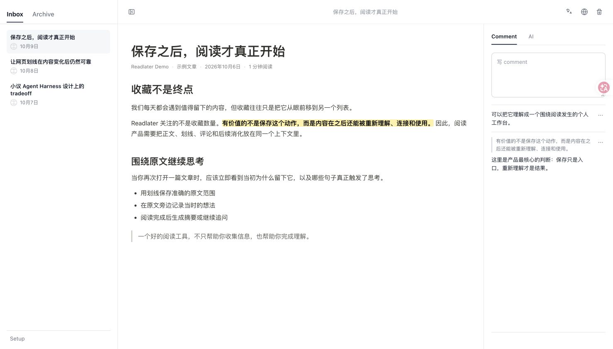
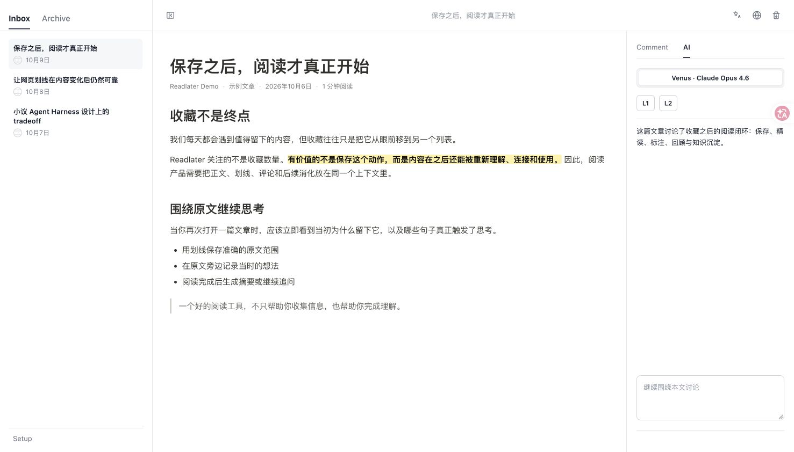
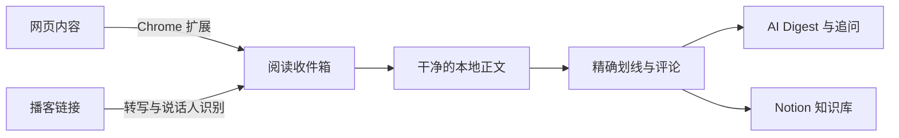
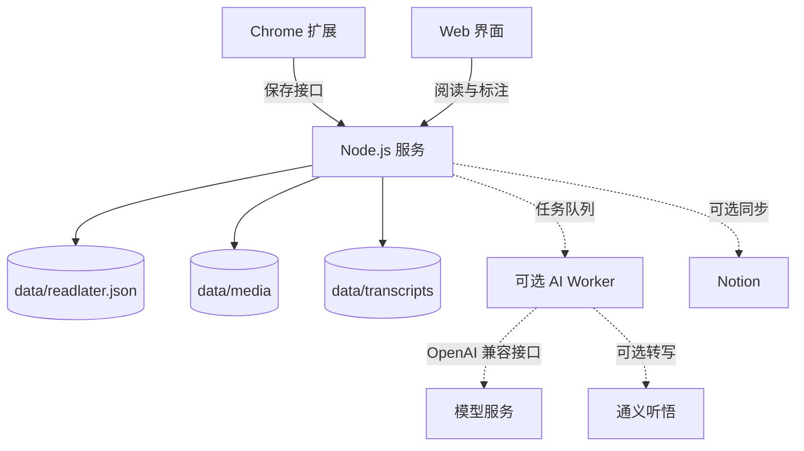

# Readlater

> 一个可自行部署的阅读收件箱：保存网页，专注阅读，留下精确划线与想法，再把内容沉淀成可复用的知识。

[](LICENSE)


## 页面截图

以下截图由当前版本的真实页面在 Chrome 中运行后截取，内容使用隔离的示例数据。

### 阅读、划线与评论

<p align="center">
  
</p>

左侧管理收件箱与归档，中间保留文章结构和划线位置，右侧集中展示文章评论以及与原文绑定的标注。

### AI Digest 与连续追问

<p align="center">
  
</p>

AI 面板与当前文章共享上下文，可以基于标注生成 L1 Digest、让 AI 先读先标注，或继续围绕本文讨论。

Readlater 不是另一个“只进不出”的收藏夹。它希望接住保存之后的第二段旅程：从浏览器收下一篇文章或导入一期播客，阅读干净的本地正文，标出真正重要的句子，记录当时的想法，并按需生成摘要或同步到 Notion。

## 它解决什么问题

收藏很容易，重新打开、读完并形成自己的理解却很难。Readlater 把这条链路放在一个小而完整的自托管应用中：

- **保存真正有用的版本**：通过 Chrome 扩展保存普通网页、X 帖子和微信公众号文章，保留语义化 Markdown 与文章图片。
- **把播客变成可读正文**：导入小宇宙单集或公开音频链接，通过通义听悟转写、自动识别说话人，并按时间与语义自然分段。
- **不丢失原文结构**：在专注阅读界面中保留标题、列表、表格、代码块和链接。
- **围绕原文思考**：精确划线并添加评论，支持跨链接、加粗等行内格式的文本选择。
- **继续消化内容**：按需翻译片段、生成文章 Digest、追问文章内容，或把笔记追加到 Notion。
- **掌握自己的资料库**：自行运行服务，文章、标注和下载的图片都保存在自己的数据目录中。

## 从收藏到知识沉淀



一次典型的使用过程：

1. 在浏览器中打开文章，通过扩展保存；也可以直接粘贴播客链接。
2. 从收件箱进入经过规范化处理的本地正文。
3. 选中准确的原文范围，添加划线或评论。
4. 阅读完成后归档文章，或继续生成 Digest、追问和同步笔记。

## 功能概览

| 模块 | 能力 |
| --- | --- |
| 内容保存 | Chrome 扩展、普通网页、X 帖子、微信公众号文章、播客链接、语义化 Markdown、图片本地化 |
| 播客转写 | 小宇宙与公开音频、异步任务、说话人识别、自然分段、时间戳文稿 |
| 专注阅读 | 收件箱与归档、响应式界面、保留链接、列表、表格和代码块 |
| 标注思考 | 精确划线、跨格式选择、评论、可恢复的文本锚点 |
| 内容消化 | 可选翻译、AI Digest、连续追问、Notion 追加 |
| 部署运维 | 密码登录、Bearer Token、JSON 本地存储、备份、Docker 部署 |

## 系统架构

Readlater 刻意保持轻量：一个 Node.js 服务、静态 Web 界面、基于 JSON 的本地存储、一个无需上架商店的 Chrome 扩展，以及可选的后台 AI Worker。



## 快速开始

### 环境要求

- Node.js 22 或更高版本
- pnpm 10
- Chrome 或其他 Chromium 浏览器，用于加载保存扩展

### 本地运行

```bash
git clone https://github.com/echoechoher/readlater-open-source.git
cd readlater-open-source
cp .env.example .env
corepack enable
pnpm install
pnpm dev
```

打开 [http://127.0.0.1:3000](http://127.0.0.1:3000)。

如果不只是本机临时体验，请在 `.env` 中为 `READLATER_PASSWORD` 和 `READLATER_SESSION_SECRET` 设置足够强的值。

## 安装 Chrome 扩展

1. 打开 `chrome://extensions/`。
2. 开启“开发者模式”。
3. 点击“加载已解压的扩展程序”，选择仓库中的 `extension` 目录。
4. 打开扩展设置，填写 Readlater 服务地址。
5. 如果浏览器还没有登录 Readlater，把 Setup 页面显示的 Bearer Token 填入扩展。

扩展默认申请 HTTPS 页面访问权限，因为自行部署的 Readlater 可能使用任意域名。如果只在固定域名下使用，可以修改 `extension/manifest.json`，进一步收窄权限范围。

## 可选集成

下面的能力全部是可选的。不配置外部服务，也可以完成保存、阅读、划线和评论的核心流程。

<details>
<summary><strong>翻译</strong></summary>

在 `.env` 中设置兼容 OpenAI Chat Completions 的接口：

```dotenv
TRANSLATION_API_KEY=...
TRANSLATION_API_URL=https://api.openai.com/v1/chat/completions
TRANSLATION_MODEL=gpt-4o-mini
```

</details>

<details>
<summary><strong>AI Digest Worker</strong></summary>

Web 服务负责创建 Digest 任务，`pnpm worker` 负责处理任务。需要同时配置 Readlater Worker Token 和兼容 OpenAI 的模型服务：

```dotenv
READLATER_BASE_URL=http://127.0.0.1:3000
READLATER_WORKER_TOKEN=...
OPENAI_COMPAT_API_KEY=...
OPENAI_COMPAT_API_URL=https://api.openai.com/v1/chat/completions
OPENAI_COMPAT_MODEL=gpt-4o-mini
```

然后启动 Worker：

```bash
pnpm worker
```

</details>

<details>
<summary><strong>播客转写</strong></summary>

Web 服务只负责解析链接和创建任务，转写由同一个 `pnpm worker` 进程异步处理。配置通义听悟凭证后，可导入小宇宙单集链接或公开的 MP3、M4A、WAV、AAC、OGG、FLAC 链接：

```dotenv
TRANSCRIPTION_PROVIDER=tingwu
TINGWU_ACCESS_KEY_ID=...
TINGWU_ACCESS_KEY_SECRET=...
TINGWU_APP_KEY=...
TINGWU_SOURCE_LANGUAGE=cn
TINGWU_DIARIZATION_ENABLED=true
TINGWU_SPEAKER_COUNT=0
```

`TINGWU_SPEAKER_COUNT=0` 表示自动判断；双人播客也可设为 `2`。Worker Token 与启动方式和 AI Digest Worker 相同。为降低真实服务测试成本，可先用短音频执行 `pnpm smoke:tingwu -- <public-audio-url>`。

</details>

<details>
<summary><strong>Notion</strong></summary>

可以在 Setup 页面配置 Notion，也可以使用 `NOTION_TOKEN` 和 `NOTION_PARENT_PAGE_ID` 环境变量。建议创建专用 Integration，并且只授予目标页面所需的最小权限。

</details>

## 数据与隐私

运行时数据保存在 `data/` 目录中，并已从 Git 排除。最重要的路径是：

- `data/readlater.json`：文章、设置、划线、评论和任务状态
- `data/media/`：下载到本地的文章图片
- `data/transcripts/`：按文章和版本保存的时间戳转写片段

`.env`、Worker 日志、浏览器自动化状态和全部运行时数据都不会进入仓库。即便如此，在公开自己的 Fork 前，仍建议检查完整 Git 历史中是否曾误提交凭据。

## 部署与开发

- [部署指南](DEPLOYMENT.md)：Docker、反向代理、数据持久化和备份
- [测试指南](TESTING.md)：自动化测试和浏览器回归场景
- [贡献指南](CONTRIBUTING.md)：本地开发流程和 Pull Request 要求
- [安全策略](SECURITY.md)：如何私下报告安全问题

运行自动化检查：

```bash
pnpm test
node --check server.mjs
node --check public/app.js
node --check extension/content-script.js
```

## 项目状态

Readlater 最初是一个个人工具，目前正在逐步开放。项目中仍会保留一些明确的产品取舍，欢迎提交 Issue 和范围清晰的 Pull Request。

## 开源协议

[MIT](LICENSE)
